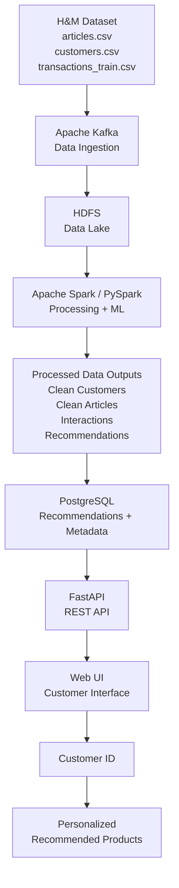
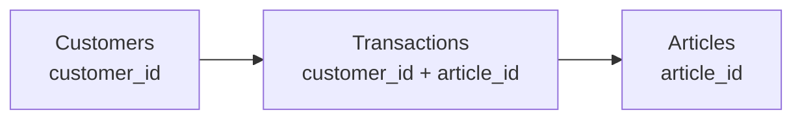
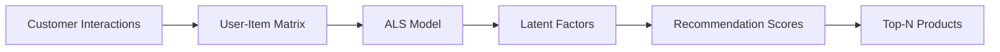
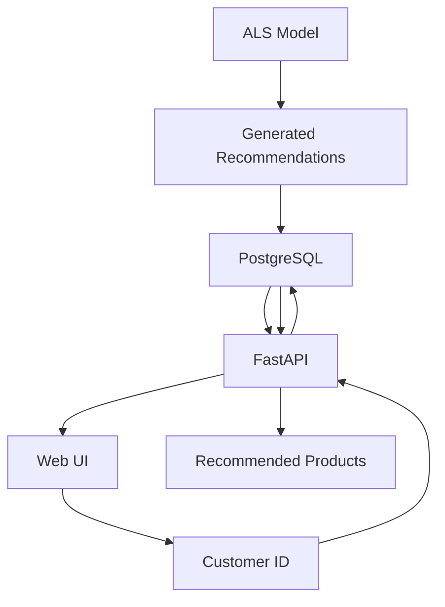

<div align="center">

# H&M Personalized Fashion Recommendation System

### End-to-End Big Data & Machine Learning Recommendation Platform
## Dataset

This project uses the [H&M Personalized Fashion Recommendations](https://www.kaggle.com/competitions/h-and-m-personalized-fashion-recommendations/data) dataset from Kaggle.

The dataset contains three primary files:

- `articles.csv` — Product/article information
- `customers.csv` — Customer information
- `transactions_train.csv` — Historical customer-product interactions

<p>
  
  
  
  
  
  
  
  
  
</p>

<p>
  <a href="https://github.com/mahmoud-abdelrahman333/hm-data-lake">Repository</a>
  ·
  <a href="https://github.com/mahmoud-abdelrahman333/hm-data-lake/tree/main/spark">Spark</a>
  ·
  <a href="https://github.com/mahmoud-abdelrahman333/hm-data-lake/tree/main/kafka">Kafka</a>
  ·
  <a href="https://github.com/mahmoud-abdelrahman333/hm-data-lake/tree/main/web">API / Web</a>
</p>

</div>

---

## Overview

This project implements an **end-to-end Big Data recommendation platform** for personalized fashion recommendations using the H&M Personalized Fashion Recommendations dataset.

Instead of treating recommendation as an isolated machine learning task, the system demonstrates a complete data journey:

**Raw Data → Ingestion → Data Lake → Distributed Processing → Recommendation Model → Database → REST API → Web UI**

The platform combines **data engineering, distributed storage, Spark-based processing, collaborative filtering, database serving, and API development** into one integrated pipeline.

---

## Business Problem

Modern fashion e-commerce platforms operate with large product catalogs and extensive customer interaction histories. Finding relevant products manually can become difficult as the number of available products increases.

This project addresses that challenge by using historical customer-product interactions to generate personalized recommendations.

### Business Value

- Personalized product discovery
- Improved customer experience
- More relevant product suggestions
- Scalable recommendation infrastructure
- Data-driven personalization
- Foundation for future real-time recommendation systems

> **Note:** No artificial business or performance metrics are claimed in this project.

---

## Solution

The proposed platform follows a layered architecture:

```text
H&M Dataset
   │
   ├── articles.csv
   ├── customers.csv
   └── transactions_train.csv
          │
          ▼
     Apache Kafka
     Data Ingestion
          │
          ▼
        HDFS
    Data Lake Storage
          │
          ▼
   Apache Spark / PySpark
   ┌─────────────────────┐
   │ Data Cleaning       │
   │ ETL                 │
   │ Feature Engineering │
   │ Interaction Matrix  │
   │ ALS Recommendation  │
   └─────────────────────┘
          │
          ▼
   Processed Outputs
          │
          ▼
      PostgreSQL
  Recommendations + Metadata
          │
          ▼
       FastAPI
      REST Service
          │
          ▼
       Web UI
          │
          ▼
      Customer ID
          │
          ▼
 Personalized Recommendations
```

---

# System Architecture

The system is organized into seven logical layers.

| Layer | Technology | Responsibility |
|---|---|---|
| Data Sources | H&M CSV | Raw customer, product, and transaction data |
| Ingestion | Apache Kafka | Large-scale data movement |
| Storage | HDFS | Distributed Data Lake storage |
| Processing & ML | Apache Spark / PySpark | ETL, feature engineering, and ALS |
| Serving Database | PostgreSQL | Stores application-ready recommendations |
| API | FastAPI | Exposes recommendations through REST |
| Application | Web UI | Customer-facing recommendation interface |

### Architecture Flow



---

# Dataset

The system uses three primary H&M dataset files.

### `articles.csv`

Contains product/article catalog information.

| Field | Description |
|---|---|
| `article_id` | Unique product identifier |
| Product type | Product classification |
| Product category | Product grouping |
| Color | Product color information |
| Product metadata | Additional article attributes |

### `customers.csv`

Contains customer information.

| Field | Description |
|---|---|
| `customer_id` | Unique customer identifier |
| Customer attributes | Customer profile information |

### `transactions_train.csv`

Contains historical customer-product interactions.

| Field | Description |
|---|---|
| `customer_id` | Customer identifier |
| `article_id` | Product identifier |
| `t_dat` | Transaction date |
| Purchase interaction | Historical product interaction |

### Dataset Relationship



The `transactions_train.csv` dataset connects customers with the products they interacted with, allowing the system to construct the user-item interaction data required by the recommendation model.

---

# Data Engineering Pipeline

## 1. Data Ingestion — Apache Kafka

Kafka is used as the ingestion layer.

The project contains:

- `kafka/producer.py`
- `kafka/consumer_to_hdfs.py`

The producer reads the three H&M CSV files and publishes their records to the `hm-raw` Kafka topic. The consumer receives the data and transfers it toward HDFS.

This creates a clear separation between **data production** and **data storage**.

---

## 2. Data Lake — HDFS

HDFS provides distributed storage for the raw data.

The Docker environment includes dedicated Hadoop NameNode and DataNode services.

The project configures HDFS through:

```text
hadoop/
├── core-site.xml
└── hdfs-site.xml
```

HDFS acts as the persistent Data Lake layer before distributed processing.

---

## 3. Distributed Processing — Apache Spark / PySpark

Spark performs the core data engineering and machine learning workflow.

The Spark module contains:

```text
spark/
├── read_hm.py
├── clean_hm.py
├── processing_hm.py
├── feature_engineering.py
├── als_model.py
├── load_recommendations.py
└── analytics.py
```

The processing workflow covers:

- Reading data
- Cleaning
- Transformation
- ETL
- Feature engineering
- Building customer-product interactions
- Preparing model input
- Training ALS
- Generating recommendations
- Loading recommendation results

---

# Machine Learning

## Collaborative Filtering

The recommendation engine uses **collaborative filtering**.

The central idea is to learn customer preferences from historical interactions rather than requiring customers to explicitly describe their preferences.

The model uses relationships between:

```text
Customer ID ↔ Article ID
```

to discover latent preference patterns.

## User-Item Interaction Matrix

Transaction history is transformed into a representation of interactions between customers and products.

```text
              Articles
          A1   A2   A3   A4
       ┌────────────────────
 C1    │  1    0    1    0
 C2    │  0    1    1    0
 C3    │  1    0    0    1
       └────────────────────
      Customers
```

The resulting interaction data becomes an input to the ALS model.

## ALS Recommendation Model

**Alternating Least Squares (ALS)** is used for collaborative filtering.

Conceptually:



The model produces recommendation scores that are then ranked to generate the final recommendations.

---

# Spark Outputs

Spark transforms the raw data into application-ready outputs.

The processing layer can produce:

- Clean customer data
- Clean article/product data
- Processed transaction/interactions
- Feature data
- Recommendation results
- Customer → recommended article mappings

The recommendation results are then prepared for storage in PostgreSQL.

---

# Recommendation Serving

The serving architecture separates **model execution** from **customer requests**.



Instead of retraining or executing the complete Spark/ALS workflow for every request, generated recommendations are stored in an application-ready database and retrieved through the API.

---

# REST API

The backend is implemented with **FastAPI**.

The current API exposes:

### Get Recommendations

```http
GET /api/recommendations/{customer_id}
```

The endpoint retrieves up to 10 recommendations for the requested customer, ordered by recommendation rank.

The response includes information such as:

```json
{
  "customer_id": "customer_id",
  "recommendations": [
    {
      "article_id": 123,
      "prod_name": "Product",
      "product_type": "Product Type",
      "product_group": "Product Group",
      "department": "Department",
      "section": "Section",
      "rank": 1,
      "prediction": 0.95
    }
  ]
}
```

### Health Check

```http
GET /api/health
```

Returns:

```json
{
  "status": "ok"
}
```

The API is connected to PostgreSQL and serves recommendation results to the web application.

---

# Web Application

The web layer provides the customer-facing interface.

The flow is:

```text
Customer enters ID
        ↓
Web UI
        ↓
FastAPI
        ↓
PostgreSQL
        ↓
Recommendation Results
        ↓
Products displayed to customer
```

The API service is containerized and exposed on port `8000` in the current Docker Compose configuration.

---

# Technology Stack

| Technology | Role |
|---|---|
| **Apache Kafka 4.0.1** | Data ingestion and scalable data movement |
| **Apache Hadoop / HDFS 3.4.1** | Distributed Data Lake storage |
| **Apache Spark 3.5.7** | Distributed data processing |
| **PySpark** | Spark development using Python |
| **Spark MLlib ALS** | Collaborative filtering |
| **PostgreSQL 16** | Recommendation and metadata storage |
| **FastAPI** | REST API and backend service |
| **Python** | Data engineering and application development |
| **Docker** | Containerized infrastructure |
| **Linux** | Development environment |
| **Git / GitHub** | Version control and collaboration |

---

# Docker Infrastructure

The project uses Docker Compose to run the main infrastructure components.

Current services include:

```text
┌─────────────────────────────────────┐
│           Docker Network             │
│                                     │
│  ┌──────────┐     ┌──────────┐     │
│  │ NameNode │────▶│ DataNode │     │
│  └──────────┘     └──────────┘     │
│                                     │
│  ┌──────────┐     ┌──────────┐     │
│  │  Kafka   │     │  Spark   │     │
│  └──────────┘     └──────────┘     │
│                                     │
│  ┌──────────┐     ┌──────────┐     │
│  │PostgreSQL│◀───▶│ FastAPI  │     │
│  └──────────┘     └──────────┘     │
└─────────────────────────────────────┘
```

The repository currently defines:

- Hadoop NameNode
- Hadoop DataNode
- Kafka
- Spark
- PostgreSQL
- FastAPI application

---

# Project Structure

The current repository is organized into major technology-specific modules:

```text
hm-data-lake/
│
├── hadoop/
│   ├── core-site.xml
│   └── hdfs-site.xml
│
├── kafka/
│   ├── producer.py
│   └── consumer_to_hdfs.py
│
├── spark/
│   ├── read_hm.py
│   ├── clean_hm.py
│   ├── processing_hm.py
│   ├── feature_engineering.py
│   ├── als_model.py
│   ├── load_recommendations.py
│   └── analytics.py
│
├── web/
│   ├── api.py
│   ├── Dockerfile
│   ├── requirements.txt
│   └── static/
│
├── docker-compose.yml
├── .gitignore
└── README.md
```

---

# Getting Started

## Prerequisites

Recommended environment:

- Linux
- Python 3
- Docker
- Docker Compose
- Git

## Clone the Repository

```bash
git clone https://github.com/mahmoud-abdelrahman333/hm-data-lake.git
cd hm-data-lake
```

## Python Virtual Environment

For Python-based local development:

```bash
python3 -m venv .venv
source .venv/bin/activate
```

The web service dependencies are defined in:

```text
web/requirements.txt
```

Current web dependencies include:

```text
fastapi
uvicorn
psycopg2-binary
```

## Start the Infrastructure

From the project root:

```bash
docker compose up -d
```

Check running containers:

```bash
docker compose ps
```

## Access the Services

Depending on the local environment:

| Service | Port |
|---|---:|
| HDFS NameNode UI | `9870` |
| HDFS RPC | `8020` |
| HDFS DataNode UI | `9864` |
| Kafka | `9092` |
| PostgreSQL | `5432` |
| FastAPI | `8000` |

For the API:

```text
http://localhost:8000
```

Health check:

```text
http://localhost:8000/api/health
```

Swagger documentation is available through FastAPI's standard documentation interface when the service is running.

---

# Project Goals

- Build an end-to-end Big Data pipeline
- Ingest large H&M datasets
- Store raw data in a distributed Data Lake
- Process data using PySpark
- Perform ETL and feature engineering
- Build customer-product interactions
- Train an ALS recommendation model
- Generate personalized recommendations
- Store results in PostgreSQL
- Expose recommendations through FastAPI
- Deliver recommendations through a Web UI
- Demonstrate scalable Data Engineering architecture

---

# Scalability

The architecture is designed around technologies that support distributed workloads.

### Distributed Storage

HDFS provides distributed storage for large datasets.

### Distributed Processing

Spark allows transformations and machine learning workloads to be executed across a distributed processing environment.

### Scalable Ingestion

Kafka separates data ingestion from downstream storage and processing.

### Processing vs. Serving

The architecture separates heavy data processing and recommendation generation from application serving.

### Containerization

Docker provides a reproducible environment for the core infrastructure components.

---

# Future Improvements

Potential extensions include:

- Real-time customer interaction streaming
- Real-time recommendation updates
- Cloud deployment
- Advanced ranking models
- Deep learning recommendation models
- User behavior tracking
- Model monitoring
- A/B testing
- Recommendation quality evaluation
- Production-grade observability
- Automated pipeline orchestration

---

# Project Screenshots

> Add project screenshots here as they become available.

Recommended structure:

```text
docs/
├── architecture.png
├── pipeline.png
├── web-ui.png
├── api-response.png
└── ...
```

Then embed them in this README using:

```markdown

```

### Web Application

_Add the actual Web UI screenshot here._

### Pipeline

_Add the actual Kafka / HDFS / Spark pipeline screenshot here._

### API Response

_Add the actual FastAPI response screenshot here._

### Recommendation Output

_Add the actual recommendation output screenshot here._

---

# Team

| Member | Role |
|---|---|
| **Mahmoud Abdelrahman Mahmoud** | Project Development Team |
| **Monzer Mahmoud** | Project Development Team |
| **Ahmed Rashad Fathy** | Project Development Team |
| **Youssef Mohamed Ali Abdelgawad** | Project Development Team |

---

# Repository

<div align="center">

### Explore the Project

[](https://github.com/mahmoud-abdelrahman333/hm-data-lake)

[**github.com/mahmoud-abdelrahman333/hm-data-lake**](https://github.com/mahmoud-abdelrahman333/hm-data-lake)

</div>

---

# Dataset Disclaimer

This project uses the **H&M Personalized Fashion Recommendations** dataset for educational and project-development purposes.

This project is not affiliated with or endorsed by H&M.

---

<div align="center">

### Built with Data Engineering + Big Data + Machine Learning

**Kafka · HDFS · Spark · ALS · PostgreSQL · FastAPI · Docker**

</div>


